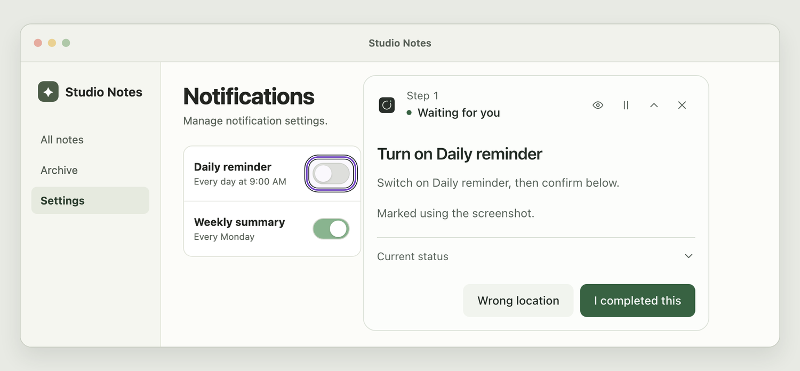

<div align="center">


# HandoffGlass

**エージェント向けのデスクトップ注釈と操作ガイド**

[English](README.md) · [简体中文](README.zh-CN.md) · [**日本語**](README.ja.md)

</div>

HandoffGlass は、デスクトップ上で操作対象を示し、ユーザーによる操作が必要な手順を表示します。操作の完了後、エージェントは結果を確認してタスクを続行できます。



*サンプルアプリで毎日のリマインダーをオンにするデモ。*

## インストール

ローカルの Codex に送ってください。

```text
https://github.com/BurntRoses/handoffglass/blob/main/docs/INSTALL_AGENT.md に沿って、この PC の Codex に HandoffGlass をネイティブプラグインとしてインストールしてください。インストールを確認し、新しいチャットで接続を確認する方法を教えてください。
```

インストール後は新しいチャットを開くとツールが読み込まれます。[Codex への手動インストール](docs/CODEX_PLUGIN.md)や[ほかのエージェントとの接続](docs/HARNESS_PLUGINS.md)も参照できます。

## 主な機能

- **画面上の注釈** ボタンやメニュー、入力欄を円、矢印、ハイライトで示します。
- **背景に合わせた配色** 背景色とのコントラストを確保し、明暗の縁取りでマークを見やすくします。
- **操作ガイド** 案内を一時停止し、元のチャットから再開できます。
- **スクリーンショットによる位置指定** macOS 14 以降では、画面収録の許可とユーザーの確認を経て、選択したアプリの撮影可能なウィンドウを 1 台のディスプレイから共有できます。エージェントはスクリーンショット上の対象をデスクトップに表示します。

**プロンプト例**

> HandoffGlass を使って毎日のリマインダーをオンにする手順を案内してください。操作を完了したら、設定を確認してください。

## 開発環境とフィードバック

主な開発・テスト環境は、Apple シリコン搭載 Mac 上の Codex です。Windows やほかのエージェントでの利用についても、フィードバックを歓迎します。

バグ報告や機能提案は [Issues](https://github.com/BurntRoses/handoffglass/issues) へお願いします。バグ報告には OS、エージェント、再現手順を記載してください。[プルリクエスト](https://github.com/BurntRoses/handoffglass/pulls)も受け付けています。

[ドキュメント](docs/INDEX.md) · [ビルドと更新](docs/COMMUNITY_RELEASE.md)

## ライセンス

HandoffGlass は [PolyForm Noncommercial 1.0.0](LICENSE) を採用しています。ライセンスの条件に従い、非商用での利用、改変、再配布が無償で可能です。再配布時はライセンスと著作権表示を保持してください。商用利用には権利者の別途許諾が必要です。
