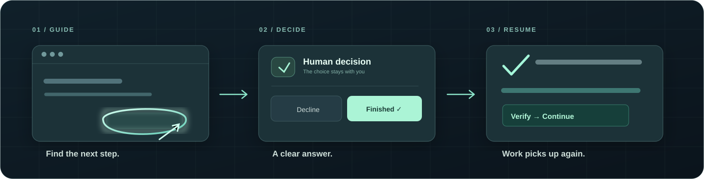

<div align="center">


# HandoffGlass

**エージェント向けのデスクトップ注釈と操作ガイド**

HandoffGlass は、デスクトップ上で操作対象を示し、ユーザーによる操作が必要な手順を表示します。操作の完了後、エージェントは結果を確認してタスクを続行できます。

[English](README.md) · [简体中文](README.zh-CN.md) · [**日本語**](README.ja.md)



</div>

ソース公開 · 非商用利用は無料 · [ライセンス](LICENSE)

## インストール

ローカルの Codex に送ってください。

```text
https://github.com/BurntRoses/handoffglass/blob/main/docs/INSTALL_AGENT.md に沿って、この PC の Codex に HandoffGlass をネイティブプラグインとしてインストールしてください。インストールを確認し、新しいチャットで接続を確認する方法を教えてください。
```

## 使い方

「ゴミ箱を空にする方法を教えて」と伝えるだけです。他の作業中も、人の操作が必要になれば画面上で案内できます。

接続を停止または削除するときは、「HandoffGlass を無効にして」「Codex から HandoffGlass を削除して」と伝えてください。状態を確認してから、HandoffGlass が書き込んだ内容だけを削除します。アプリの「接続」画面からも操作できます。

Codex では [ネイティブプラグイン](docs/CODEX_PLUGIN.md)を利用できます。MCP・Skill・必要時に起動するローカル描画プロセスを同梱し、単独アプリは不要です。Hooks は任意です。

## 開発環境とフィードバック

主な開発・テスト環境は、Apple シリコン搭載 Mac 上の Codex です。Windows やほかのエージェントでの利用についても、フィードバックを歓迎します。

バグ報告や機能提案は [Issues](https://github.com/BurntRoses/handoffglass/issues) へお願いします。バグ報告には OS、エージェント、再現手順を記載してください。[プルリクエスト](https://github.com/BurntRoses/handoffglass/pulls)も受け付けています。

<details>
<summary>ドキュメント</summary>

[エージェント向けインストール手順](docs/INSTALL_AGENT.md) · [Codex](docs/USE_WITH_CODEX.zh-CN.md) · [その他のホスト](docs/INTEGRATIONS.md) · [開発](docs/DEVELOPMENT.md) · [一覧](docs/INDEX.md)

[ビルド・更新・公開状況](docs/COMMUNITY_RELEASE.md)。[PolyForm Noncommercial](LICENSE) に基づき、非商用での利用・改変・再配布は無料です。商用利用には別途許諾が必要です。

</details>
