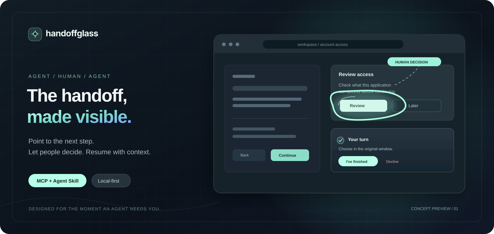
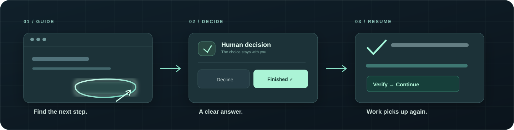

<div align="center">


# HandoffGlass

**The handoff, made visible.**

A local interaction layer for AI agents. Point to the next step, bring a human into the loop, and return control with a clear outcome.

[**English**](README.md) · [简体中文](README.zh-CN.md) · [日本語](README.ja.md)

[Get started](#get-started) · [Integrations](#integrations) · [Visual system](#visual-system) · [Documentation](#documentation)



</div>

[Installation & setup guide](site/getting-started.html)

[First-run desktop guide](docs/ONBOARDING.md) · [Interface system](docs/INTERFACE_SYSTEM.md)

[Brand & app icons](docs/BRAND.md) · [Interface system](docs/INTERFACE_SYSTEM.md)

## A better moment between agent and human

Agents can work for hours. Sometimes the next step is yours: sign in, review access, choose an account, or make a decision. HandoffGlass makes that moment visible on your desktop—without breaking the agent's workflow.

| | |
|:--|:--|
| **Point, don't describe** | Rings, arrows, spotlights and layered scenes for a specific UI target. |
| **Ask, don't assume** | A dedicated handoff panel for completion, refusal and cancellation. |
| **Return with context** | Machine-readable status, with the final result verified by the calling agent. |
| **Stay local** | Shared on-device broker, opt-in native UI targeting and locally stored visual preferences. |

## See it in action




```text
Agent                     HandoffGlass                         You
  │                            │                               │
  ├── locate + guide ──────────►│  draw a focus / point         │
  ├── request handoff ─────────►│  show a separate decision UI ─►│
  │                            │◄──────── complete / decline ──┤
  │◄── session outcome ────────┤                               │
  ├── verify the actual result │                               │
  └── continue the task        │                               │
```

Try the [interactive scene gallery](examples/scene-gallery.html) with `npm run gallery`, or open the [multilingual product preview](site/index.html) with `npm run site:preview`.

## Get started

**Node.js 22+** · **macOS / Windows** · an MCP-capable desktop agent

```bash
git clone https://github.com/BurntRoses/handoffglass.git
cd handoffglass
npm ci
npm run verify
npm run configure
```

Add the printed configuration to your agent, or connect a local stdio MCP server directly:

```json
{
  "mcpServers": {
    "handoffglass": {
      "command": "node",
      "args": ["/absolute/path/to/handoffglass/src/mcp.mjs"]
    }
  }
}
```

Configuration varies by host. The generator handles Claude, Codex, Cursor, VS Code, Gemini CLI, Trae and others. For the installed desktop preview, see [Native runtime](docs/NATIVE_RUNTIME.md). To inspect the visual overlay on your own computer, run `npm run desktop:demo`.

## Integrations

**One protocol. Multiple agents.** The MCP server and the local broker are shared; host adapters handle the differences.

`Claude Code` · `Codex` · `Cursor` · `VS Code` · `Gemini CLI` · `TRAE` · `Cline` · `Windsurf` · `OpenCode` · `Zed`

DeepSeek Harness also has a [Cordis plugin](integrations/deepseek-harness/). Tencent WorkBuddy has an [MCP + Skill connector](integrations/workbuddy/). Both remain subject to host-side acceptance testing. See the [integration matrix](docs/COMPATIBILITY.md) and [China harness integration](docs/CHINA_HARNESS_INTEGRATION.md).

## Visual system

Six scene templates. Seven SVG primitives. Layers that can be updated in place. A restrained range of motion—from a quiet focus ring to an illustrated, hand-drawn cue. The same renderer powers the desktop overlay and the gallery.

```bash
npm run gallery
npm run scene:templates
npm run preferences -- set visualStyle=handdrawn
```

User preferences take precedence over an agent's presentation choices. Native element lookup is opt-in. The overlay doesn't click or approve anything on your behalf.

## Documentation

| Explore | Build | Integrate |
|:--|:--|:--|
| [Visual language](docs/VISUAL_LANGUAGE.md) | [Architecture](docs/ARCHITECTURE.md) | [Host compatibility](docs/COMPATIBILITY.md) |
| [Scene protocol](docs/SCENE_PROTOCOL.md) | [MCP + Skill](skills/visual-handoff/SKILL.md) | [Native runtime](docs/NATIVE_RUNTIME.md) |
| [Motion & interaction](docs/VISUAL_MOTION.md) | [Agent development guide](AGENTS.md) | [Security & privacy](docs/SECURITY.md) |

<sub>Private engineering preview · Windows and macOS installers are unsigned preview builds. GitHub Actions verifies packages and MCP startup; desktop interaction still needs on-device acceptance. Repository license: UNLICENSED.</sub>
