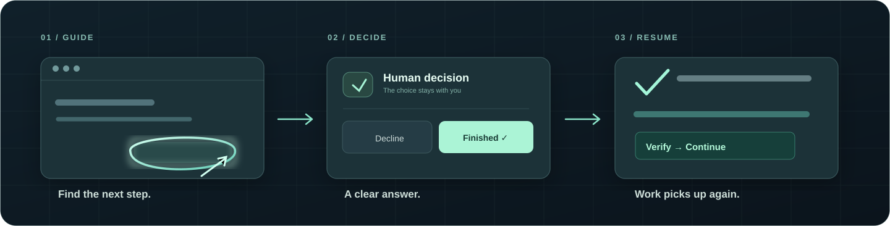

<div align="center">


# HandoffGlass

**The next step, on your screen.**

When your agent needs you to act, it points out where, waits, and continues the task.

[**English**](README.md) · [简体中文](README.zh-CN.md) · [日本語](README.ja.md)



</div>

Source available · Free for noncommercial use · [License](LICENSE)

## Install

Send this to your agent:

```text
Please install https://github.com/BurntRoses/handoffglass
```

## Use

Tell your agent what you need: “Show me how to empty the Trash.” During other tasks, it can also guide you when a step needs your input.

To disable or remove a connection, tell the agent to “disable HandoffGlass” or “clean HandoffGlass from Codex.” It checks the integration first and removes only HandoffGlass-owned content. The same actions are available from the app’s Connections page.

For Codex, use the [native plugin trial](docs/CODEX_PLUGIN.md) for MCP + Skills and an on-demand local renderer. Command hooks are optional; only enhanced mode needs hook review.

This is a plugin preview. Native Codex installation and tool discovery are tested; model tasks with a human decision, independent verification and continuation remain unverified. See [host setup](docs/HARNESS_PLUGINS.md) and the [host evidence matrix](docs/HOST_EVIDENCE.md) before trying an adapter.

<details>
<summary>Documentation</summary>

[Agent installation instructions](docs/INSTALL_AGENT.md) · [Codex](docs/USE_WITH_CODEX.zh-CN.md) · [Other hosts](docs/INTEGRATIONS.md) · [Development](docs/CODEX_HANDOFF.md) · [All docs](docs/INDEX.md)

Before a device trial, run `npm run test:preacceptance` in a prepared checkout. This checks source and isolated protocols without installing a host or calling a model. [Plugin release checks](docs/COMMUNITY_RELEASE.md#prepare-the-plugin-trial) do not require signing a separate App.

Local macOS / Windows · MCP-capable agent · Engineering preview

[Builds, upgrades and release status](docs/COMMUNITY_RELEASE.md). Free for noncommercial use, modification and redistribution under the [PolyForm Noncommercial License](LICENSE). Commercial use requires separate permission; see [usage terms](LICENSING.md).

</details>
