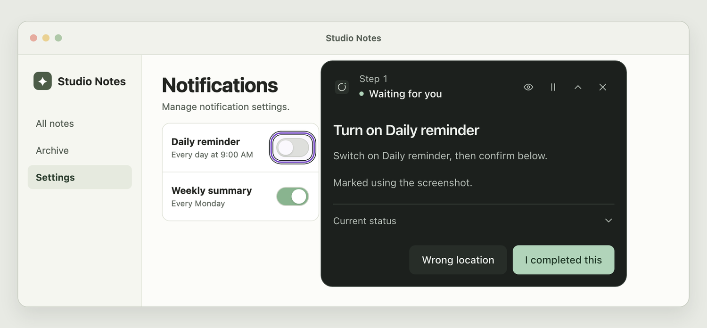

<div align="center">


# HandoffGlass

**Desktop annotations and step-by-step guidance for agents**

[**English**](README.md) · [简体中文](README.zh-CN.md)

</div>

HandoffGlass marks controls directly on the desktop and presents steps that require user input. Once the user completes a step, the agent can verify the result and continue the task.



*Desktop demo in a sample app.*

## Install in Codex · 一句话安装

Copy this into a chat with your local Codex agent:

```text
Install HandoffGlass as a native plugin in my local Codex. Follow https://github.com/BurntRoses/handoffglass/blob/main/docs/INSTALL_AGENT.md, check the installation, and tell me how to verify the connection in a new chat.
```

也可以直接发给本机 Codex：

```text
请按 https://github.com/BurntRoses/handoffglass/blob/main/docs/INSTALL_AGENT.md 在我的本机 Codex 安装 HandoffGlass 原生插件，检查安装是否成功，并告诉我怎么在新聊天里确认连接。
```

The plugin runs on your desktop. You can open a new chat after installation to load its tools. See the [Codex setup guide](docs/CODEX_PLUGIN.md) for manual installation or [other supported hosts](docs/HARNESS_PLUGINS.md).

## Features

- **On-screen annotations** Place circles, arrows, or highlights over buttons, menus, and fields.
- **Adaptive colors** Use available background colors to select a contrasting mark. Light and dark outlines improve visibility.
- **Step-by-step guidance** Pause a guided task and resume it in the original chat.
- **Screenshot positioning** On macOS 14 or later, the user can confirm sharing the capturable windows of a selected app on one display. The agent can mark the corresponding location on the desktop. Screen recording permission is required.

**Example prompt**

> Use HandoffGlass to show me how to turn on Daily reminder. Check the setting after I confirm.

## Development and feedback

HandoffGlass is primarily developed and tested with Codex on Apple silicon Macs. Feedback from Windows and other agent environments is welcome.

Report bugs and request features through [Issues](https://github.com/BurntRoses/handoffglass/issues). When reporting a bug, include the operating system, agent, and steps to reproduce it. Contributions are welcome via [pull requests](https://github.com/BurntRoses/handoffglass/pulls).

[Documentation](docs/INDEX.md) · [Builds and upgrades](docs/COMMUNITY_RELEASE.md)

## License

HandoffGlass uses [PolyForm Noncommercial 1.0.0](LICENSE). Noncommercial use, modification, and redistribution are free under the license. Redistribution requires retaining the license and copyright notice. Commercial use requires separate permission from the rights holders.
