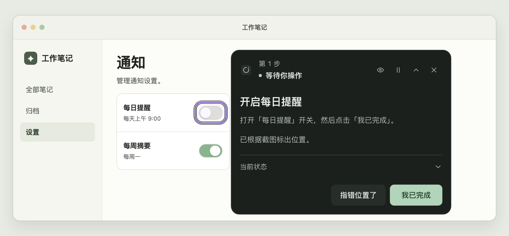

<div align="center">


# HandoffGlass

**面向 Agent 的桌面标注与分步引导**

[English](README.md) · [**简体中文**](README.zh-CN.md)

</div>

HandoffGlass 在桌面上标注应用控件，并显示需要用户参与的操作步骤。用户完成操作后，Agent 可核对结果并继续任务。



*在示例应用中开启每日提醒。*

## 一句话安装

把这句话发给本机 Codex：

```text
请按 https://github.com/BurntRoses/handoffglass/blob/main/docs/INSTALL_AGENT.md 在我的本机 Codex 安装 HandoffGlass 原生插件，检查安装是否成功，并告诉我怎么在新聊天里确认连接。
```

插件在本机运行。装好后，新开一个聊天加载工具。也可以查看 [Codex 手动安装步骤](docs/CODEX_PLUGIN.md)或[其他 Agent 的接入方式](docs/HARNESS_PLUGINS.md)。

## 主要功能

- **原位标注** 在按钮、菜单或输入框上叠加圆圈、箭头或高亮。
- **自适应配色** 根据可用的背景颜色选择对比度较高的标记颜色，使用深浅双描边提高辨识度。
- **分步引导** 支持暂停引导，并在返回原会话后继续当前任务。
- **截图定位** 在 macOS 14 及以上，经用户确认后可分享指定应用在单个显示器上的可捕获窗口。Agent 可将截图中的目标标注到桌面原位置。此功能需要屏幕录制权限。

**示例指令**

> 用 HandoffGlass 指引我打开每日提醒。我确认完成后，请检查开关状态。

## 开发环境与反馈

主要开发和测试环境为 Apple 芯片 Mac 上的 Codex。欢迎提交在 Windows 或其他 Agent 环境中的使用反馈。

通过 [Issues](https://github.com/BurntRoses/handoffglass/issues) 报告问题或提出建议，也欢迎提交 [Pull Request](https://github.com/BurntRoses/handoffglass/pulls)。报告问题时，请注明操作系统、Agent 和复现步骤。

[使用文档](docs/INDEX.md) · [构建与升级](docs/COMMUNITY_RELEASE.md)

## 许可

HandoffGlass 采用 [PolyForm Noncommercial 1.0.0](LICENSE)。可以按许可证免费进行非商业使用、修改和再分发。再分发须保留许可证及版权声明。商业使用需要权利人另行许可。
