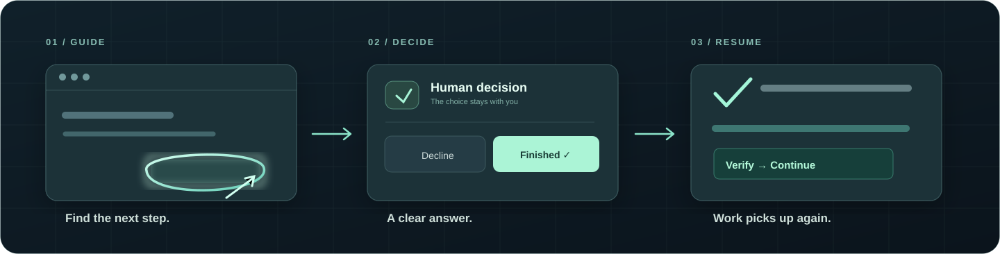

<div align="center">


# HandoffGlass

**下一步，指给你看。**

Agent 需要你操作时，在屏幕上指出位置，等待你完成，再继续任务。

[English](README.md) · [**简体中文**](README.zh-CN.md) · [日本語](README.ja.md)



</div>

源码可用 · 非商业用途免费 · [许可证](LICENSE)

## 安装

发给你的 Agent：

```text
请安装 https://github.com/BurntRoses/handoffglass
```

## 使用

直接说“教我清空废纸篓”。执行其他任务时，遇到需要你亲手操作的步骤，Agent 也可以在屏幕上指引你。

如果要停用或移除连接，直接告诉 Agent“停用 HandoffGlass”或“清理 Codex 里的 HandoffGlass”。Agent 会先读取连接状态，给出清理预览，只删除 HandoffGlass 自己写入的内容；也可以在应用的「连接」页面完成停用和卸载。

如果使用 Codex，推荐安装[原生插件试用版](docs/CODEX_PLUGIN.md)：默认包含 MCP、Skill 和按需启动的本地绘制进程，无需独立 App。生命周期 Hooks 为可选增强，选择后才需审核。

目前为插件试用版。Codex 原生插件的安装和工具发现已测试；包含人类决策、独立核验和继续任务的真实模型闭环仍待实测。试用各宿主接入前，请查看[安装步骤](docs/HARNESS_PLUGINS.md)和[验证状态](docs/HOST_EVIDENCE.md)。

<details>
<summary>文档</summary>

[Agent 安装要求](docs/INSTALL_AGENT.md) · [Codex](docs/USE_WITH_CODEX.zh-CN.md) · [其他宿主](docs/INTEGRATIONS.md) · [开发](docs/CODEX_HANDOFF.md) · [全部文档](docs/INDEX.md)

依赖准备后，运行 `npm run test:preacceptance` 完成源码与隔离协议检查；不会安装宿主或调用模型。[插件发布检查](docs/COMMUNITY_RELEASE.md#prepare-the-plugin-trial)无需先为独立 App 购买签名证书。

本地 macOS / Windows · 支持 MCP 的 Agent · 测试预览

[构建、升级与发布状态](docs/COMMUNITY_RELEASE.md)。依据 [PolyForm 非商业许可](LICENSE)，可免费用于非商业使用、修改和再分发；商用需另行授权。详见[许可说明](docs/LICENSING.md)。

</details>
