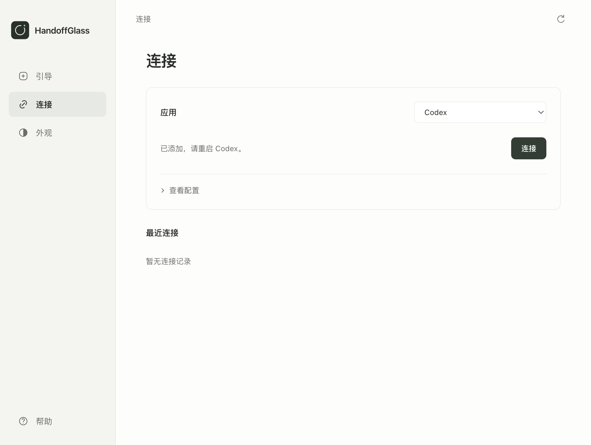

# Agent integration · 0.17.0

The user supplies intent such as “教我清空废纸篓”. The host agent chooses the tool, observes the app, points at the next action, waits, and checks the app before continuing. Tool names, coordinates and orchestration are not user input.

## Changes

- MCP initialize supplies a self-contained instruction under 512 characters for tool selection and continuation; no manual prompt invocation is needed.
- `ui_inspect` reads at most 48 foreground control labels. It excludes editable fields and values, checks visibility/grounding before exposing bounds, rejects app changes, and uses the existing local and OS consent boundary. Labels remain untrusted data.
- Every session response carries `nextAction`, including compact output. Completion remains `verified:false` and requires an independent app check.
- The Connect action installs the implicit `visual-handoff` skill and merges one Codex MCP server. A parsed before/after comparison protects unrelated TOML settings; updates have private backups. Unsupported layouts fail without rewriting.
- An older running broker returns an actionable restart instruction for the new observation capability.

## Evidence

| Check | Result |
|---|---|
| Full repository, unit and scene checks | 139 tests pass |
| MCP initialize and dual-client integration | 10 standard tools, server instructions, ownership, cancellation and scene updates pass |
| Extras integration | 13 tools pass |
| Local connection check | Pass; this isolated check does not verify host adoption |
| Native macOS AX fixture | Discovers the button without its name as input; live movement, lost/recovered target and resize pass |
| Native geometry | Center error 0 DIP; AppKit AX size difference 2 DIP |
| Real release UI | Connect writes real config and skill in a disposable home; preferences, language, collapsed details, panel refusal and narrow windows pass |
| Source desktop | Broker, app and Electron-MCP entrypoints, focus and display geometry pass |
| Packaged MCP | 10 tools, initialize instructions, native helper and bundled Codex skill installer pass |
| Packaged desktop | App and Electron-MCP entrypoints, real display and two-client handoff/cancel pass |
| Skill validation | Pass using an isolated Python environment |
| Local Codex update | MCP config and skill installed; all unrelated config values independently compared and preserved |

## Limits

These checks establish tool availability and the desktop loop, not a model's natural-language tool-selection quality. A fresh host conversation must still be evaluated with the one-sentence request. No real Trash contents were deleted. Bounded control labels alone cannot prove an empty Trash; the host needs an appropriate independent state check or must report the limit. Windows UIA has automated contract coverage but was not exercised on physical Windows hardware in this run. The local macOS archive is unsigned and unnotarized.
