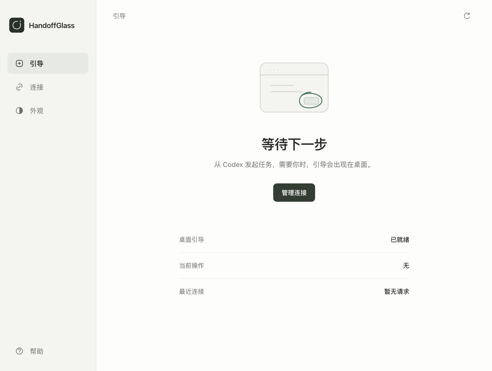
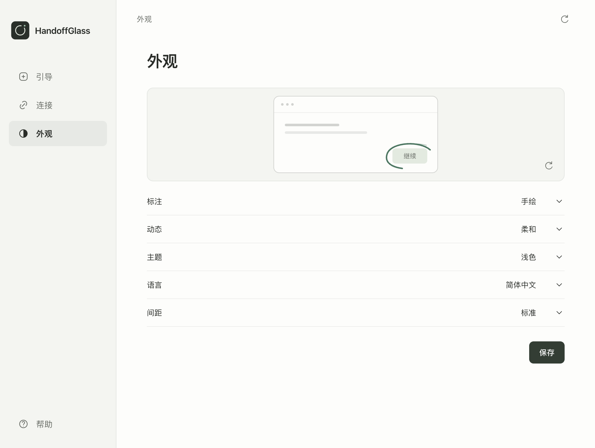

# Desktop interface · 0.16.0

macOS 26.6.2 / Apple Silicon / Electron 44.8.0 / one real display. Screenshots below are production windows captured through Electron; fixture text and decisions use an isolated temporary runtime. No files were deleted.

## Changes

- Short Chinese and English copy; neutral light/dark surfaces; SVG navigation.
- Primary navigation: guidance, connections and appearance. Help remains at the bottom.
- Configuration, version, diagnostics and event records collapsed by default.
- One-column setup and a smaller decision panel. A missing target shows an action-specific note; the countdown appears only in the final minute.
- Interactive appearance preview uses the same renderer and motion CSS as the desktop overlay. Unsaved previews do not change stored preferences.
- New installations default to minimal marks. Existing saved choices are preserved.
- Element lookup remains explicit opt-in. The help checkbox saves immediately; OS permission is separate.
- Unified inset app icon, source-mode Dock icon and properly scaled 1×/2× monochrome macOS template icons.
- Opening the standalone app shows its window; opening it again brings settings forward. Native edit/window menus remain available.

## Verification

| Check | Result |
|---|---|
| `npm run handoff:check` | 131 tests; syntax, repository links/version checks and three scene fixtures passed |
| `npm run test:integration` | Real MCP stdio; nine tools, two clients, ownership, scenes and cancellation passed |
| `npm run connection:check` | Local headless handshake passed; does not establish that this Codex chat has loaded tools |
| `npm run test:release-ui` | Shared preview, unsaved/saved preferences, language, permission persistence, closed disclosures, narrow width, setup and real panel decline passed |
| `npm run test:desktop` | Broker, app and Electron-MCP startup; focus retention, bounds and display rebuild passed |
| `npm run test:packaged` | Bundled MCP and native helper resolution passed |
| `npm run test:desktop:packaged` | Packaged app and packaged MCP desktop startup, two clients, visual guidance and cancellation passed |
| `npm run verify:dist` | 0.16.0 ARM64 ZIP and SHA-256 generated |

The archive is unsigned and unnotarized. No physical external-display test or real Finder deletion was performed in this pass. The [Codex setup and Trash prompt](../USE_WITH_CODEX.zh-CN.md) describes the next real workflow; deletion requires the user's action in Finder and independent verification.

## Screenshots

