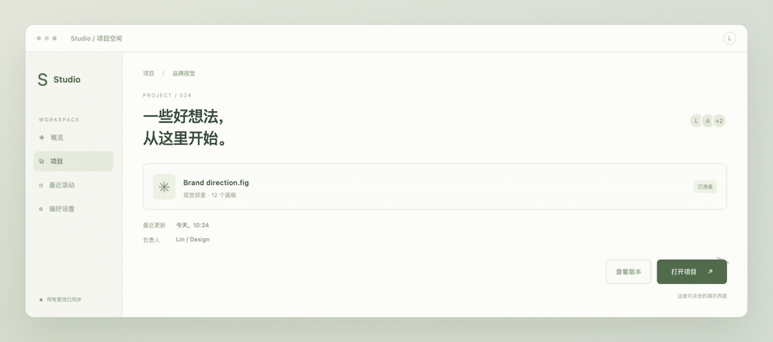
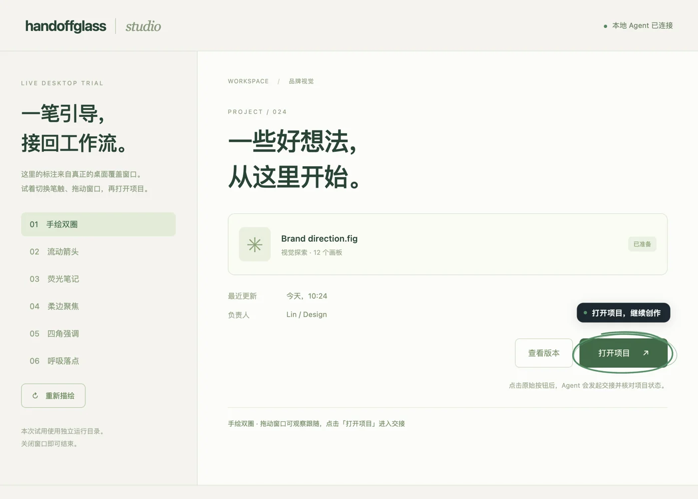
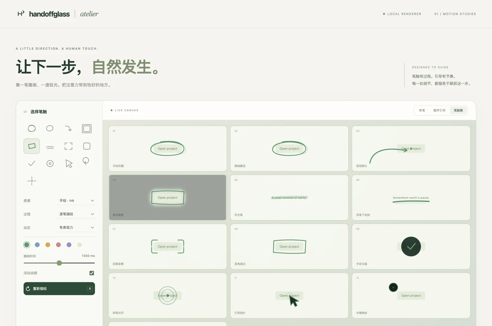

# 2026-10-20 · 视觉打磨与 Agent 桌面试用

环境：macOS 26.6.2 / ARM64，单块 Retina 屏幕 1710×1107 DIP、scale 2；Node 24.19.0、Electron 44.8.0。分支 `codex/expressive-visual-guidance`，基于 `d47dc4e`。本轮按用户要求暂缓物理外接屏幕。

## 实际改动

- 重做开放箭头、圈线、圆角框、双笔下划线、角标、说明卡与聚焦蒙版；新增荧光笔、四角框、勾画、手绘双圈、光环、矢量指针。
- 13 种标记 / 9 个模板；三种质感、四种局部过程、单标记延迟与时长。长行顺序引导自动采用四角框。
- 逐笔描绘使用规范化路径长度；不移动真实落点。稳定快照复用节点，几何变化保留播放进度；目标隐藏时清空播放缓存，恢复后重新起笔。
- 单个共享羽化蒙版、多 SVG 独立资源 ID、轻量说明卡的四向避让；系统减少动态效果时仍完整显示笔迹。
- 新增 `visual:trial`：独立临时 Broker、真实 stdio MCP 和生产桌面覆盖层；原始测试按钮 → 交接面板 → MCP 等待/事件 → Agent 独立读取项目状态。

## 本机结果

| 检查 | 结果 |
|---|---|
| 单元测试 | 131/131，通过场景参数边界、原子更新、节点/时钟保持、羽化与独立资源、文字/标签边界 |
| `test:integration` / `test:extras` | 9 / 12 工具，全部形状和四种 effect 通过真实 MCP；非法 effect 被拒绝且不改状态 |
| `connection:check` | passed，9 工具；隔离 headless 诊断 |
| `test:desktop` | Node MCP / 独立 app / Electron Node MCP 三种真实启动通过；双客户端、焦点、完整 DIP 覆盖、显示事件重建及设置中心通过 |
| `test:visual` | 六组生产效果、真实描绘进度、稳定节点、丢失/恢复、移动保留时钟、系统减少动态效果、焦点和完整交接通过 |
| 试用窗口跟随 | 实时 DOM 测量 + 全局内容区原点 + MCP scene patch；一次测量约 166 ms |
| 场景更新往返 | 24 次，p50 10 ms / p95 17 ms；包含专用窗口测量，不是通用性能基准 |
| Accessibility 手绘模板 | 真实 AppKit + helper + Broker；中心误差 0 DIP，宽高最大误差 2 DIP（AX 边框每侧 1 DIP） |
| 原生跟随时延 | 首次 885 ms、移动 548 ms、恢复 781 ms、缩放 960 ms；隐藏时旧标注清除 |
| Atelier | 1440 DIP 宽桌面 / 390 DIP 宽窄屏无水平溢出；13 标记、6 个顺序引导标记、独立蒙版资源；原始按钮事件通过 |

自动交接的点击来自专用测试脚本，结果为 `completed / user_report / verified:false`；Agent 另行读取原界面 `opened:true`。此项是合成操作回归，不能记为真人交互验收。`visual:trial` 保留人工操作入口。

截图由专用 Electron 测试窗口和生产覆盖层合成，不捕获其他应用。预览动图展示与生产相同的 SVG/CSS，属于画布演示；桌面图为真实 Broker/MCP 路径。

## 渲染证据







## 复现

```bash
npm run handoff:check
npm run test:integration
npm run test:extras
npm run connection:check
npm run test:desktop
npm run test:native:macos
npm run test:visual -- --output=.tmp/visual-qa
npm run visual:trial
npm run gallery
```

最后重复焦点检查时系统进入锁屏；独立空白 Electron 窗口也无法获得焦点，IOConsole 状态确认 `CGSSessionScreenIsLocked=Yes`。该次重复未通过，不能覆盖上表中锁屏前已完成的记录；解锁后须补验。交互试用允许等待解锁，自动回归仍要求前台焦点。

## 边界与后续

- 本轮没有更改用户保存的外观与定位同意设置；临时测试运行目录单独清理。
- 窗口移动试用测量来自专用 DOM；原生跟随数据来自独立 AppKit 目标，二者分别记录。
- 标签采用有限候选避让，密集区域仍可能重叠；长段解释应放入交接面板。
- 本轮没有新打包或签名发行，旧 `dist/` 仍是上一轮构建；新效果通过源码运行。Windows 与物理外接屏未在本轮验收。
- PR #23 的 GitHub Actions 没有开始执行：check-run `118196117341` 注释明确为账户付款失败或 spending limit 不足；上游 PR #22 同样受阻。本轮本机结果不等于托管 CI 通过。
- `bench:context` 固定合成 JSON：full 856 bytes、compact 231 bytes，减少 73.01%；保留状态和 verification。该数据不是实际 tokenizer token 数或端到端模型用量。所有新动效仍为本地计算。

[Agent 试用说明](../AGENT_VISUAL_TRIAL.md) · [动效约定](../VISUAL_MOTION.md) · [上一轮 macOS 验收](2026-10-19-macos.md)
