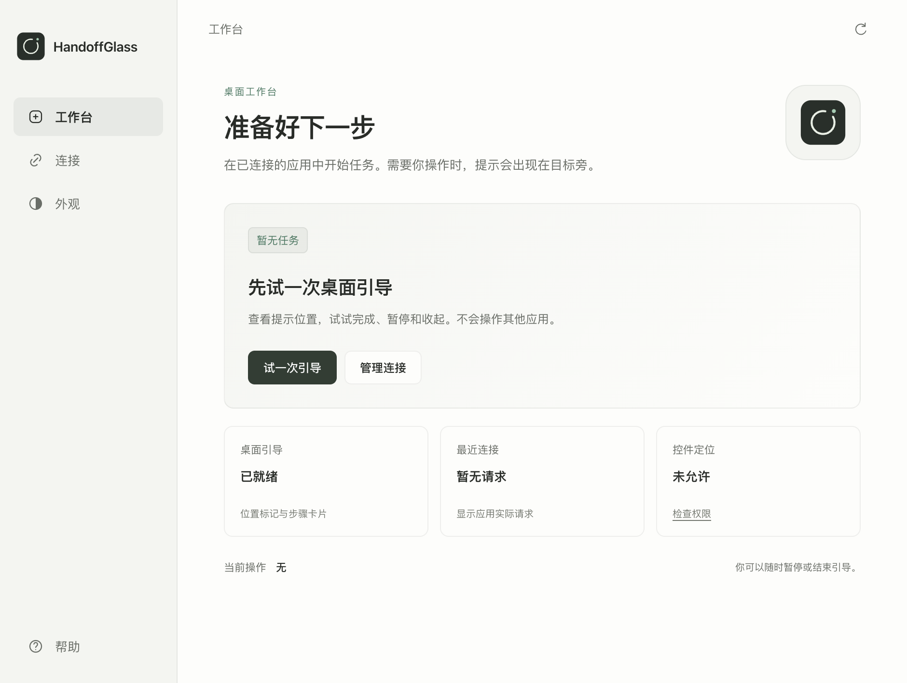
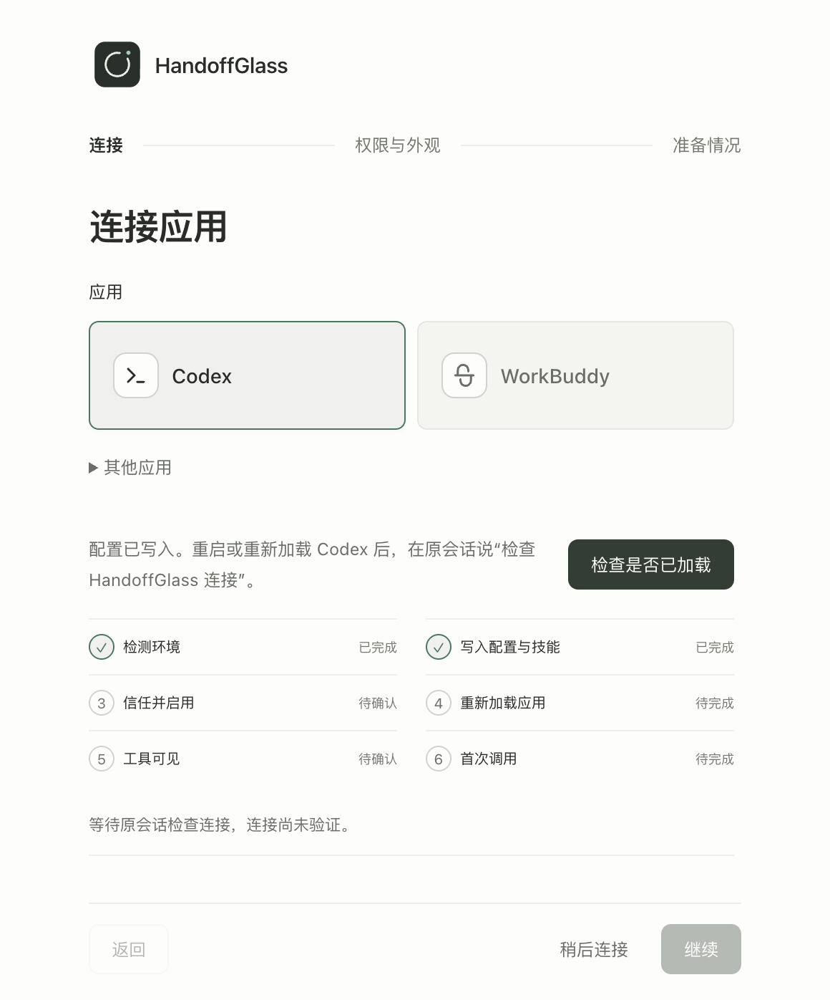
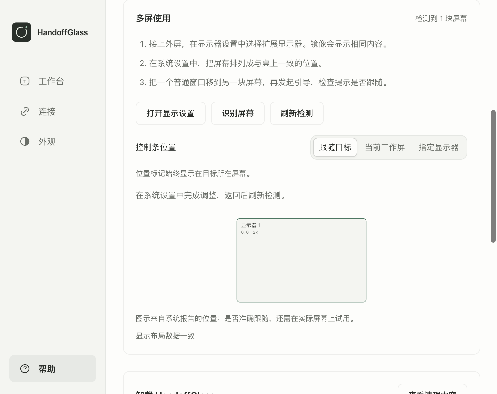

# 0.18 升级实现与验收

实施：2026-11-04 至 11-05。基线：`d4611a7` / 0.17.0。环境：macOS 26.6.2（Darwin 25.6.0）、Apple silicon、Node 24.22.1、Electron 44.10.2、一块系统报告的显示器。范围：连续任务、原生查询、桌面界面、接入与卸载；未重新接入用户的 Codex 或 WorkBuddy。

## 已交付

| 问题 | 0.18 行为 | 验证 |
|---|---|---|
| 第二步沿用初始短期限 | 任务、步骤、敏感确认分别计时；普通步骤暂停后重新观察；敏感确认不延期 | 在第 299 秒进入下一步、独立确认过期等单元测试 |
| guide 无法进入核实 | 普通可观察步骤允许独立核实；敏感操作仍需用户报告 | 核实状态及非法推进测试 |
| 重连后被旧 owner 占用 | 带范围的恢复令牌、轮换与撤销旧 owner；私有最小重启检查点 | 真实 Broker 重启及双 MCP 客户端恢复 |
| 每次查询启动 helper | 常驻 JSON-line worker、原生引用、macOS AX 通知、Windows 自适应检查；超时/崩溃后重建 | worker 故障、队列、引用与跟随测试；Swift 编译 |
| 手动完成是唯一入口 | 支持可靠的 `target_absent` 候选事件，仍由 Agent 独立核实 | 事件来源及未验证状态回归 |
| 状态和界面脱节 | 工作台、目标旁卡片、步骤号、收起条、暂停/恢复、就地恢复；只显示实际报告阶段与等待租约 | 隔离 Electron 真实渲染和交互 |
| 配置写入被当作连接成功 | 按安装 ID 匹配成功调用，拆分配置、本地检查和宿主调用证据；缺证据不能完成连接向导 | 连接状态和安装匹配测试、首次向导回归 |
| 权限延迟到任务中途 | 接入时集中显示本地选择、系统授权和 helper 状态；状态查询不枚举控件 | 权限、关闭总开关及确定性降级测试 |
| Agent 反复处理工具和几何 | 版本化能力摘要、简化 Skill、有效 `targetRef`、本地语义模板与恢复动作 | MCP initialize、18 个默认工具、引用范围及场景测试 |
| 清理入口不完整 | App、CLI、MCP 共用预览/卸载；清理接入，等待本地服务退出，再启动外部移除器；保留编辑及未知内容 | 真实外部移除器、CLI 关闭隔离 Broker、包内卸载测试 |

普通连续步骤默认 30 分钟，任务默认 8 小时；敏感确认最长 5 分钟。后续步骤更新步骤期限，位置更新不续期。恢复只保存身份、令牌摘要、步骤和期限；不保存任务文字、控件内容、坐标或原始恢复令牌。

三步本地试用只确认 HandoffGlass 自己的卡片与控制条，不代表宿主接入、控件定位或外部任务成功。多屏设置包含屏幕布局、识别屏幕和控制条显示策略；本次不把合成布局测试列为物理多屏验收。

## 检查结果

| 检查 | 结果 |
|---|---|
| `npm ci` | 通过；随后将 Electron 更新至 44.10.2 |
| `npm run handoff:check` | 199 项单元/桥接检查与场景校验通过 |
| `test:integration` / `test:extras` / `test:legacy` | 18 / 21 / 25 个工具，真实 SDK stdio、所有权、连续会话与恢复通过 |
| `npm run connection:check` | 通过，`headless:true`、`hostVerified:false` |
| `npm run test:release-ui` | 工作台、三步试用、暂停恢复、收起、旧步拒绝、长文、连接阶梯、权限、多屏设置、卸载预览及固定底部导航通过 |
| `npm run doctor` | 本地依赖与 Electron 可执行文件就绪 |
| Skill quick validation | 通过 |
| `npm audit --omit=dev --audit-level=high` | 0 漏洞 |
| `npm run build:desktop` | macOS arm64 未签名工程预览构建通过 |
| `npm run test:packaged` | 包内 MCP、原生 helper 路径、Codex 临时配置/Skill、WorkBuddy 本地包及外部完整卸载通过 |
| `npm run test:desktop:packaged` | 独立 App 与包内 MCP 唤起桌面均通过；双客户端共用 Broker、显示与取消通过 |
| `npm run test:desktop` | 三种启动路径通过；随后窗口焦点断言失败，本轮不记为整体通过 |
| `npm run test:native:macos` | 未通过：系统前台为 `loginwindow`，不是 AppKit QA 窗口；未更改系统前台或授权 |
| `npm run release:check -- --preview` | 工程预览检查通过；公开发行验收仍有待完成项 |

打包桌面测试使用临时 userData，故不登记这类测试路径为可删除的正式安装；“安装记录不可用”日志不会阻止启动。完整卸载测试在独立目录验证，不删除本次构建包或开发源码。Windows 外部移除器已纳入源码与 CI，仍需 Windows 安装环境验收。

## 性能范围

本地事件基准：55 个样本、5 次预热，Broker 记录 p95 **0.01ms**，已订阅游标等待收到事件 p95 **0.28ms**。不含系统输入、Electron 绘制、宿主调度和模型时间。

真实 renderer 点击到测试观察到 Broker 状态变化的最后一个样本约 **52.8ms**，其中包含测试的 50ms 观察轮询；这是单个样本，不是 p95。原生真实控件的冷/热查询、首帧与目标恢复延迟未在本轮取得有效测量，不宣称已达到 200ms 目标。模型耗时仍取决于宿主，长等待不能唤醒已经结束回合的模型。

## 发布仍需的实测

`release-status.json` 保持 engineering-preview；签名、公证、Windows 桌面、物理双屏/混合 DPI、真实 Codex 与 WorkBuddy 固定任务验收均未标记通过。WorkBuddy 官方连接器规范于 2026-11-04 核对：<https://open.workbuddy.cn/docs/connector>；本地包清理不等于删除宿主内部已导入连接器。

## 界面记录

以下来自隔离的真实 Electron 页面，使用本地 SVG/CSS 资源。

